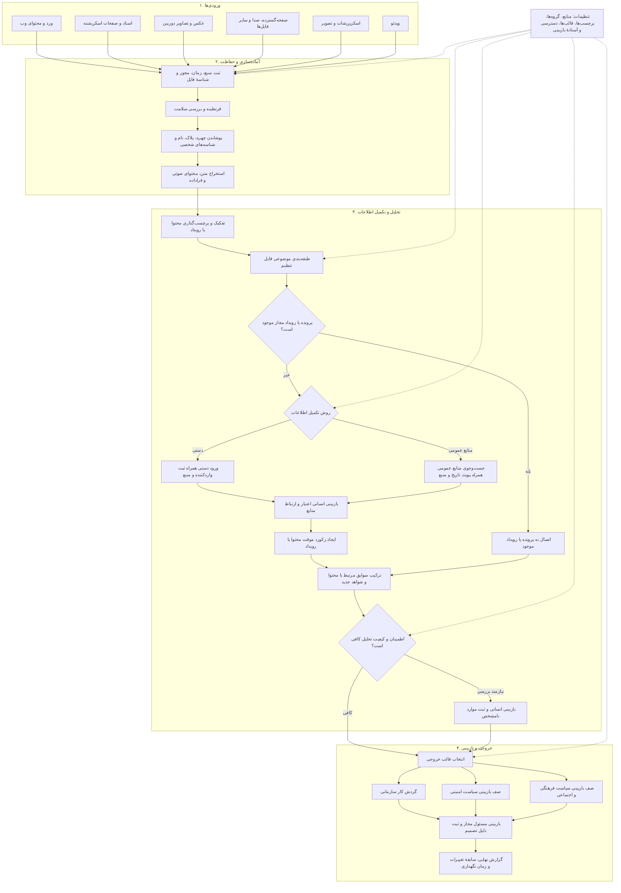
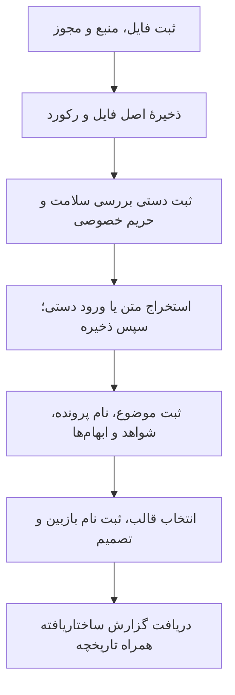
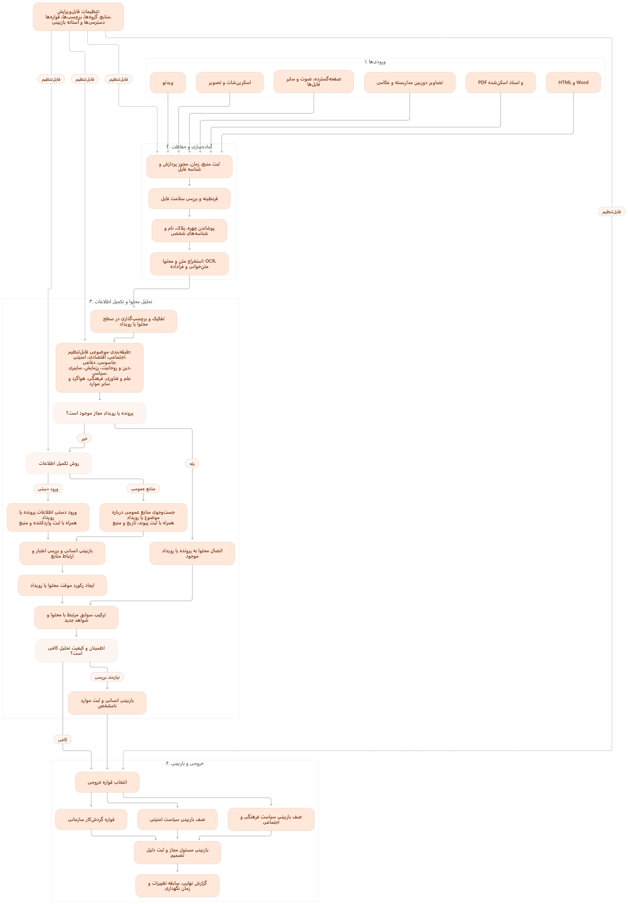

# گردش کار ساهر

## ساختار هدف

این نمودار بازنویسی قابل‌ویرایش ساختار ارسالی کاربر است؛ قابلیت‌های هدف را نشان می‌دهد، نه میزان تکمیل نرم‌افزار. در بخش تکمیل اطلاعات، موضوع بررسی پرونده یا رویداد است و منابع و تصمیم انسانی باید قابل ردیابی باشند.

موضوع‌های مدنظر شامل اجتماعی، اقتصادی، امنیتی، جاسوسی، دفاعی، دین و روحانیت، رزمایش، سایبری، سیاسی، علم و فناوری، فرهنگی، هواگرد و سایر موارد است. فهرست هدف باید قابل تنظیم باشد؛ در نسخهٔ فعلی گزینه‌های رابط ثابت‌اند.

## مسیر پیاده‌سازی‌شده

در مسیر فعلی، پرونده یا رویداد به‌صورت دستی ایجاد و با شناسه به محتوا پیوند داده می‌شود. تصمیم بازبین با حساب احرازشده ثبت می‌شود. پیشنهاد تحلیل و جست‌وجوی منابع با تنظیم کلیدهای سرویس آنلاین در دسترس‌اند. قرنطینه، اسکن ClamAV، پوشاندن چهره و پلاک تصویر ثابت و عضویت پرونده‌ای فعال‌اند. سنجش اطمینان و صف‌های سازمانی مستقل هنوز ساخته نشده‌اند. [وضعیت توسعه](DEVELOPMENT_STATUS.md) مرز هر قابلیت را مشخص می‌کند.

## فایل‌های نمودار

- [منبع قابل‌ویرایش نمودار هدف](diagrams/workflow-target.mmd)
- [تصویر اصلی ارسالی کاربر](diagrams/workflow-reference.png)

